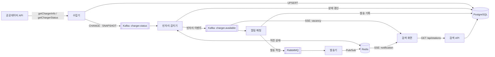

# EV 충전기 빈자리 감지 (ev-charging-station-search)

[](https://github.com/ysj13/ev-charging-station-search/actions/workflows/ci.yml)

전기차 충전소를 검색하고, 충전기가 **충전중에서 충전대기로 바뀌는 순간(빈자리)** 을 감지해 이벤트로 발행하고, 그 충전소를 구독한 사용자에게 알림을 보내는 백엔드 서비스입니다.
공공데이터포털의 [한국환경공단_전기자동차 충전소 정보](https://www.data.go.kr/data/15076352/openapi.do)를 사용합니다.

| 규모 (서울 기준) | 수치 |
|---|---|
| 충전소 / 충전기 | 12,994곳 / 75,851대 |
| 상태 수집 주기 | 2분 |
| 전체 동기화 | 약 18초 (API 호출 8회, SNAPSHOT 발행 포함) |
| 검색 응답 | 반경 1km 10ms, 가장 넓은 키워드 78ms |

## 주요 기능

| 기능 | 내용 |
|---|---|
| 충전소 검색 | 키워드(이름·주소), 시군구, 좌표 반경으로 검색. 빈자리 있는 곳만, 최소 출력 필터. 충전기별 실시간 상태 |
| 빈자리 감지 | 상태 변경을 Kafka로 받아 충전중 → 충전대기 전이를 찾고 `charger.available` 이벤트로 발행 |
| 검색 화면 | 지도에서 보이는 영역의 충전소를 빈자리 수와 색으로 표시. 빈자리가 생기면 서버 푸시(SSE)로 바로 알림 |
| 빈자리 알림 | 충전소를 구독하면 자리가 날 때 알림. 구독 매칭 → RabbitMQ 발송 작업 → Redis Pub/Sub → SSE, 중복 발송 방지·재시도·DLQ |
| 시연 도구 | 원하는 충전기 상태를 주입하거나 화면의 버튼으로 테스트 빈자리를 만들어 알림까지 재현 (개발 환경 전용, 기본 꺼짐) |

## 아키텍처



| 구성요소 | 하는 일 |
|---|---|
| 수집기 | 기동 시·매일 04시 전체 동기화(충전소 정보 + 모든 충전기 상태를 SNAPSHOT으로 발행), 2분마다 최근 바뀐 상태 수집 |
| 빈자리 감지기 | `charger.status`를 배치로 소비해 직전 상태(Redis)와 비교. 기존 충전기의 상태를 DB에 쓰는 유일한 주체 (새 충전기의 초기값만 동기화가 씀) |
| 검색 API | PostgreSQL에서 조건 검색과 충전기 상태 집계 |
| 실시간 스트림 | 인스턴스마다 `charger.available`을 최신 위치부터 구독해 연결된 화면에 SSE로 전달 |
| 알림 매칭 | `charger.available`을 구독과 맞춰 발송 기록을 만들고, RabbitMQ에 넣은 뒤 브로커 확인을 받아 오프셋 커밋 |
| 발송기 | RabbitMQ 작업을 받아 Redis Pub/Sub으로 퍼뜨림. 각 인스턴스가 그 구독자의 SSE 연결로 전달. 3번 실패하면 DLQ |
| 메시지 키 | 충전소 ID. 같은 충전소의 상태는 같은 파티션에서 순서대로 처리 |

## 핵심 설계 결정

자세한 맥락과 검토한 대안은 [ADR](docs/adr/README.md)에 있습니다.

| 주제 | 결정 | ADR |
|---|---|---|
| 상태 수집 | 상태 조회 API는 최근 약 10분까지만 조회됨(실측). 2분 폴링 + 전체 동기화 SNAPSHOT으로 재기동·장기 장애 뒤에도 따라잡음 | [001](docs/adr/001-status-collection-and-snapshot-catch-up.md) |
| 데이터 정리 | 응답이 완전하다고 확인될 때만, 기존의 5% 이하만 삭제. 불완전한 응답으로 정상 데이터를 지우지 않음 | [002](docs/adr/002-sync-cleanup-safeguards.md) |
| 빈자리 정의 | 충전중 → 충전대기만. 운영중지·점검중 해제는 운영사 일괄 작업이라 제외(실데이터 857건 분석) | [003](docs/adr/003-vacancy-definition.md) |
| 감지 처리 | 발행 → DB → Redis 순서, 최소 한 번 발행 + `eventId` 중복 제거, 15분 지난 빈자리는 이벤트 생략 | [004](docs/adr/004-detector-ordering-and-delivery.md) |
| 상태 쓰기 | 충전기 상태를 쓰는 주체를 감지기 하나로. 동기화와의 경합 제거 | [005](docs/adr/005-single-writer-for-charger-status.md) |
| 검색 | PostGIS 없이 위경도 범위 + 하버사인, `pg_trgm`, 현재 페이지만 집계, 안정 정렬 | [006](docs/adr/006-station-search-query.md) |
| 외부 API | HTTP/1.1 고정(HTTP/2에서 무응답 실측), 네트워크 오류·5xx만 재시도, 실패한 동기화는 지수 백오프 | [007](docs/adr/007-public-api-resilience.md) |
| 메시징 역할 | Kafka는 사실(이벤트), RabbitMQ는 할 일(사용자별 발송 작업) | [008](docs/adr/008-kafka-and-rabbitmq-roles.md) |
| 화면 갱신 | 빈자리는 SSE로 즉시, 그 외 상태 변화는 2분마다 다시 조회 | [009](docs/adr/009-realtime-screen-updates.md) |
| 알림 발송 | 발송 기록(PENDING) → RabbitMQ 적재 확인 → 발송. 이벤트 발생 시각 기준 쿨다운, (구독, 이벤트) 유니크로 중복 방지 | [010](docs/adr/010-vacancy-notification-delivery.md) |

## 기술 스택

| 영역 | 기술 |
|---|---|
| 언어, 프레임워크 | Java 25, Spring Boot 4.1 |
| 화면 | HTML·CSS·JavaScript (빌드 도구 없음), 카카오맵 JavaScript API, Server-Sent Events |
| 저장소 | PostgreSQL 17 (Flyway, `pg_trgm`), Redis 8.2 |
| 메시징 | Apache Kafka 4.2 (KRaft), RabbitMQ 4.2 (알림 단계용) |
| 테스트 | JUnit Jupiter 6, Testcontainers 2, MockMvc |
| 관측 | Spring Boot Actuator, Micrometer (Prometheus) |

## 실행 방법

필요한 것: JDK 25, Docker Desktop

**1. 환경 변수 파일 만들기**

```powershell
Copy-Item .env.example .env
```

`.env`의 `DATA_GO_KR_SERVICE_KEY`에 data.go.kr 인증키를 넣습니다. Encoding/Decoding 어느 형태든 됩니다. 인증키가 없으면 수집은 건너뛰고 나머지 기능만 동작합니다.

지도를 보려면 `KAKAO_MAP_JS_KEY`에 카카오 JavaScript 키를 넣고, 카카오 개발자 콘솔에서 다음 두 가지를 설정합니다. 키가 없거나 설정이 안 되어 있으면 화면은 지도 없이 목록으로 동작합니다.

- 앱 설정 > 플랫폼 > Web: 사이트 도메인에 `http://localhost:8280` 등록
- 카카오맵 사용 설정 켜기

**2. 실행**

`bootRun`이 `compose.yaml`의 컨테이너(PostgreSQL, Redis, Kafka, RabbitMQ, Kafka UI)를 자동으로 띄웁니다.

```powershell
./gradlew bootRun
```

**3. 테스트**

Testcontainers가 테스트용 컨테이너를 따로 띄웁니다. 테스트는 기능 스위치와 수집 지역 코드를 직접 지정하므로 `.env` 설정과 관계없이 같은 결과가 나옵니다.

```powershell
./gradlew test
```

| 로컬 주소 | 용도 |
|---|---|
| http://localhost:8280 | 검색 화면 |
| http://localhost:8280/actuator/health | 상태 확인 |
| http://localhost:8290 | Kafka UI |
| http://localhost:15672 | RabbitMQ 관리 콘솔 (evcharger / evcharger) |
| localhost:15432 | PostgreSQL (evcharger / evcharger) |

## API

| 메서드 | 경로 | 설명 |
|---|---|---|
| GET | `/api/stations` | 충전소 검색 (`q`, `zscode`, `lat`+`lng` 중 하나 필수) |
| GET | `/api/stations/{stationId}` | 충전소 상세와 충전기별 상태 |
| POST | `/dev/chargers/{stationId}/{chargerId}/status` | 상태 주입 (개발 도구) |
| POST | `/dev/stations/{stationId}/test-vacancy` | 테스트 빈자리 만들기 (개발 도구) |
| GET | `/dev/vacancies` | 최근 빈자리 이벤트 (개발 도구) |
| GET | `/api/vacancies/stream` | 빈자리 실시간 스트림 (SSE). `?clientKey=`를 주면 구독 알림도 받음 |
| GET · POST | `/api/subscriptions` | 구독 목록, 구독 (`X-Client-Key` 헤더) |
| DELETE | `/api/subscriptions/{stationId}` | 구독 해지 |
| GET | `/api/notifications` | 알림함 (최근 보낸 알림) |
| GET | `/api/client-config` | 화면 설정 (카카오맵 키, 개발 도구 사용 여부) |

파라미터, 응답 형식, 오류, Kafka·RabbitMQ 메시지 형식은 [API 문서](docs/api.md)에 있습니다.

## 시연

`.env`의 `DEV_TOOLS_ENABLED`를 `true`로 바꾸고 실행한 뒤, 검색 화면을 띄운 채 상태 주입 API로 충전기를 "충전중 → 충전대기"로 바꾸면 화면에 빈자리 알림이 바로 뜹니다. 자세한 순서는 [시연 가이드](docs/demo.md)에 있습니다.

## 실측 결과

| 항목 | 결과 |
|---|---|
| 감지기 처리량 | 쌓여 있던 상태 메시지 약 8.4만 건을 약 17초에 처리 (파티션 3, 배치당 최대 500건) |
| 재기동 따라잡기 | 약 14분 중단 후 재기동 시 놓친 빈자리 전이 324건을 SNAPSHOT으로 찾음. 최근 15분 이내 101건만 발행 |
| 빈자리 정의 근거 | 1시간 이벤트 857건 중 운영중지·점검중 해제 313건(약 37%)이 운영사의 일괄 전환 → 빈자리에서 제외 |
| 반경 검색 | 위경도 인덱스로 필터 0.5ms, API 응답 10ms |

## 테스트

총 116건입니다.

| 종류 | 건수 | 내용 |
|---|---|---|
| 단위 | 43 | 공공 API 응답 파싱·인증키 인코딩·재시도, 조회 기간 계산, 동기화 재시도 백오프, 빈자리 판정, 알림 전달 메시지 검증 |
| 통합 (Testcontainers) | 70 | 동기화 UPSERT와 정리 안전장치, 빈자리 감지(장애 주입, 깨진 메시지 건너뛰기 포함), 검색 API(반경 경계·페이지 안정성·입력 오류), 빈자리 SSE 전달·연결 상한·종료 시 연결 정리, 화면 제공, 구독 API(한도·식별값 검증), 알림 전 구간(Kafka → RabbitMQ → Redis → SSE, 중복·쿨다운·해지, 구독자 1,100명 묶음 적재), 발송 실패 → FAILED·DLQ, 발송 전 해지 → CANCELLED, 테스트 빈자리 버튼(실제 경로·시연 알림 쿨다운 제외) |
| 전 구간 시나리오 | 3 | 전체 동기화 → 상태 수집 → 빈자리 감지 → 검색 반영, 반복 수집 시 한 번만 감지, 상태 주입 경로 |

공공 API만 가짜 응답으로 바꾸고 PostgreSQL, Redis, Kafka, RabbitMQ는 실제 컨테이너로 검증합니다. 공공 API 응답 형식은 실제 응답을 저장한 샘플로 확인합니다.

main 브랜치 push와 PR마다 GitHub Actions에서 전체 테스트를 실행합니다(`.github/workflows/ci.yml`).

## 프로젝트 구조

```
com.evalarm.charger
├── collector      # 공공 API 클라이언트, 전체 동기화, 상태 수집 → Kafka
├── detector       # 빈자리 감지 → charger.available, 상태 DB·Redis 반영
├── station        # 충전소·충전기 도메인, 검색 API(api), 검색 쿼리(query)
├── devtools       # 시연용 상태 주입, 최근 빈자리 조회 (기본 꺼짐)
├── common         # 설정, 메시지 형식, 오류 응답, Kafka 오류 처리
├── stream         # 실시간 스트림 (SSE)
├── subscription   # 구독 API
└── notification   # 알림 매칭(Kafka) → 발송 작업(RabbitMQ) → 발송·전달(Redis Pub/Sub), 알림함
```

데이터 모델은 [ERD](docs/erd.md)에 있습니다.

## 알려진 한계

- 충전기가 충전대기 상태여도 충전 구역에 일반 차량이 주차해 있을 수 있습니다. 공공데이터로는 알 수 없습니다.
- 원본의 상태 갱신 주기 때문에 빈자리는 수 분 늦게 감지될 수 있습니다(준실시간).
- 2글자 검색어는 트라이그램 인덱스를 쓰지 못해 전체를 훑습니다(서울 기준 약 34ms).
- 수집은 단일 인스턴스 실행을 전제로 합니다. 여러 대로 늘리면 스케줄 수집에 분산 락이 필요합니다.
- 실시간 스트림과 개발 도구는 인스턴스·재기동마다 새 컨슈머 그룹(`vacancy-stream-*`, `dev-tools-recent-vacancies-*`)을 만듭니다. 컨슈머 랙 경보를 붙일 때는 이 그룹들을 제외해야 합니다.
- 알림은 화면이 열려 있을 때 실시간으로 받습니다. 탭이 가려져 있으면 브라우저 알림을 띄우고, 화면을 닫았으면 알림함에서 봅니다(웹 푸시는 아직 없음).
- 로그인이 없어 구독자는 브라우저에 저장한 무작위 값으로 구분합니다. 다른 기기와 구독이 공유되지 않고, 이 값은 실시간 연결의 쿼리 문자열에 실리므로 운영에서는 접근 로그에서 가려야 합니다.
- 구독에 속도 제한과 만료가 없습니다. 공개 운영 전에 IP 기준 속도 제한과 오래 접속하지 않은 구독자의 구독 만료가 필요합니다.
- DLQ로 간 알림 작업은 자동으로 다시 보내지 않습니다. RabbitMQ 관리 콘솔에서 원인을 확인한 뒤 큐로 옮기면 다시 발송됩니다.
- 마이그레이션 V3의 `CREATE EXTENSION pg_trgm`에는 데이터베이스 `CREATE` 권한이 필요합니다.

## 향후 계획

| 작업 | 내용 |
|---|---|
| 웹 푸시 | 서비스 워커와 Push API로 화면을 닫아도 알림 받기 |
| 알림 운영 | 구독 속도 제한과 만료, 오래 QUEUED·PENDING인 알림 경보와 재적재 |
| 운영 | 컨슈머 랙 경보, 다중 인스턴스 수집용 분산 락 |

데이터 출처: 공공데이터포털 (data.go.kr)
