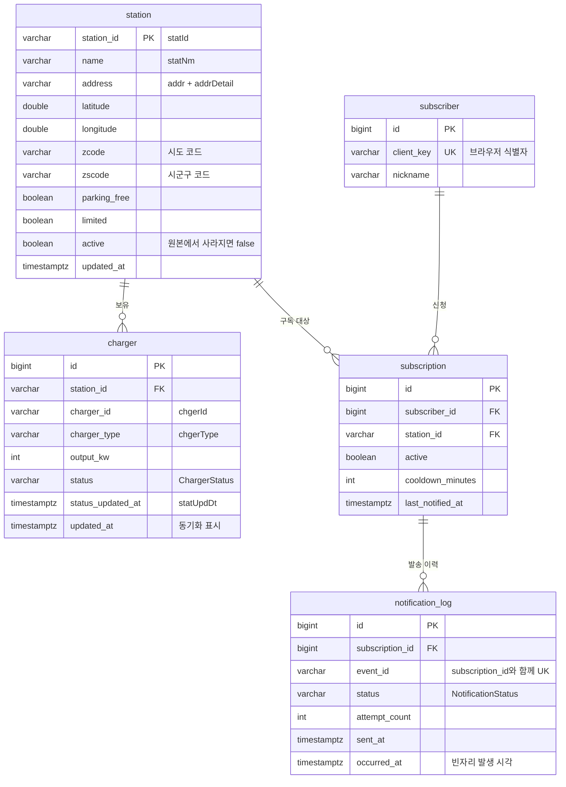

# ERD

스키마는 Flyway 마이그레이션(`src/main/resources/db/migration`)으로 관리합니다.

| 버전 | 내용 |
|---|---|
| V1 | 테이블 5개 생성 |
| V2 | `station.active` 추가 (원본에서 사라진 충전소를 지우지 않고 비활성화) |
| V3 | 검색 인덱스: 이름·주소 트라이그램(GIN, `pg_trgm`), 위경도(B-tree) |
| V4 | 시군구 코드 인덱스 |

`subscriber`, `subscription`, `notification_log`는 빈자리 알림에 씁니다([ADR-010](adr/010-vacancy-notification-delivery.md)). 구독은 해지해도 지우지 않고 `active`만 끕니다(발송 이력이 참조). `notification_log.status`는 PENDING(매칭) → QUEUED(RabbitMQ 적재 확인) → SENT(발송) / FAILED(재시도 끝에 실패) / CANCELLED(발송 전에 해지)로 바뀌고, SENT·CANCELLED가 된 뒤에는 바뀌지 않습니다.

## 컬럼별로 쓰는 주체

| 컬럼 | 쓰는 곳 | 용도 |
|---|---|---|
| `charger.status`, `status_updated_at` | 빈자리 감지기 (새 충전기만 전체 동기화가 초기값) | 검색 결과의 사용 가능 대수, 상세. 더 최신 시각일 때만 덮어씀 ([ADR-005](adr/005-single-writer-for-charger-status.md)) |
| `charger.updated_at` | 전체 동기화 | 이번 동기화 응답에 있었는지 표시. 정리 기준 ([ADR-002](adr/002-sync-cleanup-safeguards.md)) |
| `station.*` (상태 외) | 전체 동기화 | 충전소 기본 정보 |
| `station.active` | 전체 동기화 | 충전기가 하나도 남지 않은 충전소를 비활성화 |

## 설계 메모

| 결정 | 이유 |
|---|---|
| `station.station_id`는 공공데이터의 `statId`를 그대로 PK로 사용 | 외부 식별자가 안정적이고, Kafka 메시지 키로도 같은 값을 씀 |
| 상태 비교는 Redis, 조회는 PostgreSQL | 수집 주기마다 DB를 읽어 비교하지 않도록 직전 상태는 Redis에 두고, DB는 검색용 현재 상태를 보관 |
| 충전소는 지우지 않고 비활성화 | 구독 등에서 참조될 수 있음 |
| `subscription (subscriber_id, station_id)` 유니크 | 같은 충전소를 중복 구독하지 않도록 |
| `notification_log (subscription_id, event_id)` 유니크 | 빈자리 이벤트는 최소 한 번 전달되므로, 같은 이벤트로 두 번 발송하지 않도록 |
| `cooldown_minutes`, `last_notified_at` | 상태가 짧게 반복해서 바뀔 때 알림 폭주 방지 |
| 부분 인덱스 `WHERE active` | 검색은 활성 충전소만, 구독 매칭은 활성 구독만 조회 |
